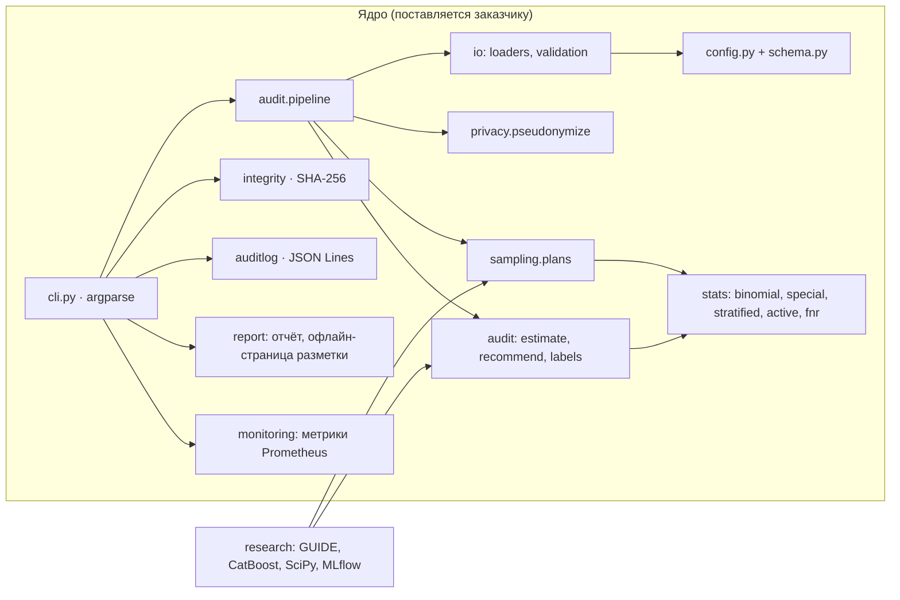
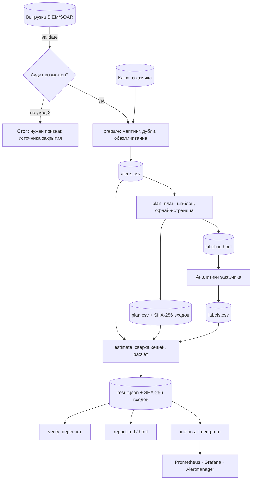

# Архитектура «Лимен»

## Принципы

1. **Офлайн.** Ядро не делает сетевых вызовов: вход — файлы выгрузки и конфигурации, выход — файлы плана, результата, отчёта и метрик ([ADR 0001](adr/0001-offline-first.md)).
2. **Гарантия — от дизайна выборки.** Границы корректны, потому что алерты для перепроверки отбираются случайно по плану, зафиксированному до разметки. Модель вендора может влиять только на ширину границы (схема `active`), но не на её корректность.
3. **Нулевое доверие к файлам.** Каждый переход через границу контура проверяется по SHA-256, а результат можно пересчитать командой `verify` ([нулевое доверие](zero-trust.md)).
4. **Минимум данных и зависимостей.** Учётные записи, хосты и адреса обезличиваются сразу после чтения выгрузки; в ядре пять сторонних библиотек ([ADR 0002](adr/0002-course-stack.md)).
5. **Ядро отделено от исследования.** `limen.research` (SciPy, CatBoost, MLflow) — необязательная часть; ядро её не импортирует, это проверяет тест.

## Компоненты

| Модуль | Ответственность |
|---|---|
| `schema.py` | Каноническая схема закрытого алерта и служебные поля плана |
| `config.py` | Модели pydantic для параметров аудита и маппингов; лишние ключи в YAML запрещены |
| `io/loaders.py` | Чтение CSV, JSON, JSONL; приведение к канонической схеме по маппингу |
| `io/validation.py` | Проверки до аудита: обязательные поля, отличимость автозакрытия от ручного, наличие вердиктов |
| `privacy/pseudonymize.py` | Ключ, псевдонимы HMAC-SHA256 для сущностей и `alert_id`, перевод идентификаторов |
| `sampling/plans.py` | Планы `uniform`, `stratified`, `active` и исследовательский `naive_top` |
| `stats/special.py` | Неполная бета-функция и обратная к ней, биномиальная и гипергеометрическая функции распределения, квантиль нормального — на стандартной библиотеке |
| `stats/binomial.py`, `stratified.py`, `active.py`, `fnr.py` | Границы Клоппера–Пирсона и гипергеометрическая, стратифицированные границы, разностная оценка, переход к FNR |
| `audit/labels.py` | Шаблон разметки, чтение и проверка меток, техника ATT&CK, политика «не знаю» |
| `audit/estimate.py`, `audit/recommend.py` | Оценка по всему потоку и по правилам, решение по правилу и размер добора |
| `audit/pipeline.py` | Подготовка, минимальная выгрузка, план с хешами входов, оценка, результат в JSON |
| `integrity.py` | SHA-256 файлов и канонического JSON, остановка при несовпадении |
| `auditlog.py` | Журнал действий в JSON Lines для SIEM заказчика |
| `report/` | Отчёт в Markdown и HTML; офлайн-страница разметки с политикой CSP |
| `monitoring/metrics.py` | Метрики в текстовом формате Prometheus, атомарная запись |
| `research/` | Загрузка GUIDE, модель-«автозакрыватель», симуляция, проверка H1, H2 и смещения |

## Поток данных

В основном режиме поставки между `prepare` и `plan` добавляется `export-minimal`: за контур уходит только минимальная таблица, а шаблон и метки переводятся между псевдонимами и исходными `alert_id` командой `translate-ids` на стороне заказчика.

## Каноническая схема

| Поле | Обязательное | Значения |
|---|---|---|
| `alert_id` | да | строка, уникальная в выгрузке; при повторе остаётся последняя запись |
| `rule_id` | да | правило корреляции; пустое значение → `__no_rule__` |
| `closing_source` | да | `auto`, `suppression`, `analyst`, `unknown` — выводится из поля выгрузки по маппингу |
| `verdict` | нет | `attack`, `benign`, `unknown` — вердикт аналитика при ручном закрытии |
| `closed_at` | нет | время закрытия (UTC) |
| `closing_reason` | нет | причина закрытия из справочника SIEM/SOAR |
| `score` | нет | оценка вероятности атаки 0..1 от вендора или своей модели; нужна для схемы `active` |
| `rule_name`, `tenant` | нет | название правила, клиент MSSP — только внутри контура |

Сущности (учётки, хосты, адреса) из `entities` маппинга заменяются колонками `<префикс>_id`; исходные колонки удаляются.

## Артефакты аудита

| Файл | Кто создаёт | Содержимое | Где хранится |
|---|---|---|---|
| `secrets/*.key` | `keygen` | 32 байта ключа HMAC | только у заказчика |
| `alerts.csv` | `prepare` | обезличенная выгрузка в канонической схеме | внутри контура |
| `minimal.csv` | `export-minimal` | поля из `MINIMAL_COLUMNS`, псевдонимы `alert_id` | может уйти исполнителю |
| `plan.csv` | `plan` | все автозакрытые алерты: страта, вероятность и признак отбора; метаданные плана, включая SHA-256 таблицы и параметров | у того, кто считает |
| `labels_template.csv`, `labeling.html` | `plan` | отобранные алерты с контекстом; офлайн-страница разметки | у аналитиков |
| `labels.csv` | аналитики | `alert_id`, метка, псевдоним аналитика, секунды, комментарий, время, техника ATT&CK | у того, кто считает |
| `result.json` | `estimate` | итог, правила, конфигурация, сводка разметки и проверки, SHA-256 входов | у заказчика |
| `report.md`, `report.html` | `report` | отчёт с агрегатами | у заказчика |
| `limen.prom` | `metrics` | метрики для Prometheus | на хосте с node_exporter |
| журнал JSON Lines | все команды с `--audit-log` | действия, хеши, результат | в SIEM заказчика |

Коды выхода командной строки: 0 — успех, 1 — ошибка входных данных, 2 — аудит по выгрузке невозможен, 3 — нарушена целостность.

## Как расширять

- **Новый источник выгрузки** — новый YAML в `configs/mappings/` без изменения кода; поля, не сверенные с документацией продукта, помечаются «ПРОВЕРИТЬ». Тест `test_configs.py` проверит его схемой.
- **Новая схема выборки** — функция в `sampling/plans.py`, ветка в `audit/estimate.py`, тест покрытия на синтетике и строка в протоколе H1. Пока схема не прошла H1, её результат помечается `finite_sample_valid = false`.
- **Новый формат отчёта** — шаблон в `report/templates/`.

## Проверки архитектуры

- `tests/test_no_network.py` падает, если в ядре появляется импорт сетевых библиотек или частей исследовательского контура: SciPy, CatBoost, MLflow, `limen.research`.
- `tests/test_configs.py` проверяет схемой все YAML из `configs/` и совпадение версии пакета с `pyproject.toml`.
- `tests/test_special.py` сверяет специальные функции ядра с точными вычислениями и со SciPy.
- `tests/test_labeling_page.py` проверяет, что политика CSP пропускает только встроенные скрипт и стили, а данные алертов не могут выйти из блока данных страницы.
